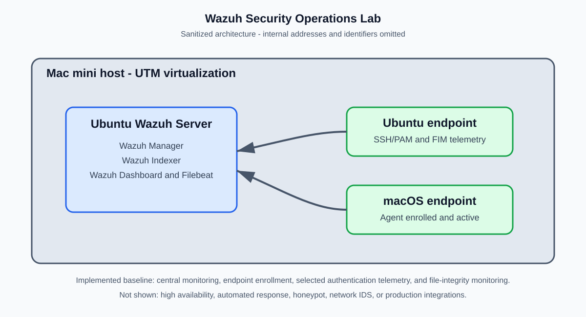

# Wazuh Security Operations Lab

> **Status: implemented and validated laboratory proof of concept.** This repository documents a self-hosted Wazuh security-monitoring lab completed as a graduate capstone. It is not an enterprise deployment and does not represent production SOC experience.

## Overview

This project deployed Wazuh 4.14.9 as a centralized monitoring platform for representative Ubuntu and macOS endpoints. The lab collected selected authentication and file-integrity events, generated alerts for controlled scenarios, and used the Wazuh dashboard to investigate a representative alert.

The project demonstrates the engineering lifecycle of a small security-monitoring implementation: deploy, enroll endpoints, configure telemetry, validate expected detections, evaluate benign controls, and document an investigation.

## Verified baseline

| Area | Verified result |
| --- | --- |
| Central platform | Wazuh Manager, Indexer, Dashboard, and Filebeat on Ubuntu Server 24.04.5 LTS |
| Endpoints | One Ubuntu endpoint and one macOS endpoint enrolled and active during validation |
| Security telemetry | Ubuntu SSH/PAM authentication events and real-time file-integrity monitoring on a designated test directory |
| Positive validation | Three authentication-failure trials and three file-integrity trials detected |
| Benign controls | Four controlled activities completed; no incorrect authentication-failure or FIM alerts attributed to them during observed test windows |
| Investigation | A file-deletion alert was reviewed and classified as authorized laboratory activity |

The results above apply only to the documented laboratory conditions. No response-time reduction, false-positive rate, enterprise coverage, or production reliability claim is made.

## Architecture



The environment used a Mac mini host with UTM virtualization, a central Ubuntu Wazuh server, a separate Ubuntu endpoint, and a macOS endpoint. The network addresses, host names, user names, and dashboard URLs are intentionally omitted from this public repository.

See [architecture notes](docs/architecture.md) and [deployment record](docs/deployment.md).

## What was validated

- Centralized visibility of two active agents.
- Detection of controlled SSH/PAM authentication failures on the Ubuntu endpoint.
- Detection of controlled file creation, modification, and deletion in a designated test directory.
- Review of four benign control activities to check for incorrect alerts in the observed windows.
- Investigation of a file-deletion alert against the corresponding documented test activity.

See the [validation record](docs/validation.md), [safe test procedures](docs/test-procedures.md), and [investigation case study](investigations/case-001-authorized-file-deletion.md).

## Repository guide

```text
.
├── architecture/            # Sanitized diagram
├── configs/                 # Safe, non-deployable configuration examples
├── docs/                    # Architecture, deployment, validation, operations, roadmap
├── evidence/                # Public evidence manifest; raw captures are intentionally withheld
├── investigations/          # Documented alert investigation
├── LICENSE
└── SECURITY.md              # Publication and secret-safety checklist
```

## Lab versus production

| Implemented in this lab | Not demonstrated or not claimed |
| --- | --- |
| Wazuh deployment and agent enrollment | Enterprise-scale SIEM administration |
| Authentication and file-integrity telemetry | High availability or disaster recovery |
| Controlled detection validation | Automated containment or response |
| Alert review and classification | 24/7 SOC operations or managed-security service delivery |
| Documented maintenance practices | Full threat-detection coverage or performance benchmarks |

## Safe reproduction

This repository is documentation-first. It intentionally omits VM images, enrollment keys, certificates, private IP addresses, user names, dashboard exports, raw logs, and full Wazuh production configuration. Start with the [deployment record](docs/deployment.md) and adapt the [FIM example](configs/wazuh-agent/ossec.conf.fim.example.xml) to an isolated environment.

Never expose a dashboard, manager, or home network to the public internet for this lab. Use synthetic activity and a separate, isolated environment for any future honeypot work.

## Roadmap

The next planned iteration is custom Wazuh detection engineering with repeatable positive and negative tests. An isolated Cowrie honeypot is a later, explicitly planned extension—not part of Version 1.

See [roadmap](docs/roadmap.md).

## License

Documentation and original diagrams in this repository are released under the [MIT License](LICENSE). Wazuh and its associated trademarks are owned by their respective holders.
